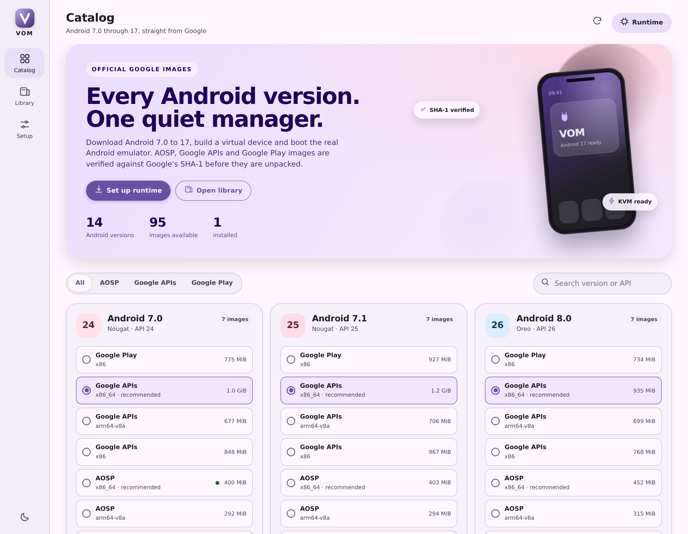

# VOM

**VOM** is a quiet Android virtual-machine manager with a Material 3
interface. It lists **Android 7.0 through Android 17** (API 24-37), downloads
the official Google system image you pick, verifies its SHA-1, creates a
standard AVD and boots the real Android emulator.

One binary. No Gradle, no Android Studio, no account, no telemetry. The
interface is served from `127.0.0.1` and opens in your browser; the same page
is an installable PWA on a phone.

```
vom
```



> **Why a desktop host?** A normal Android app cannot boot a different Android
> version inside itself: that needs root, a hypervisor (KVM/AVF) and kernel
> access that Google does not expose to third-party apps. VOM therefore drives
> **Google's own emulator** on Linux, macOS or Windows, which is exactly the
> runtime that Android Studio uses. The UI works in a desktop browser and on a
> phone browser on the same LAN.

## What it does

- **All the versions** - Android 7.0 (API 24) through Android 17 (API 37),
  including the 37.x releases that Google publishes today.
- **Real images** - AOSP, Google APIs and Google Play system images, for
  `x86_64`, `arm64-v8a` and the older `x86` packages. The catalog comes from
  `https://dl.google.com/android/repository/`.
- **Verified downloads** - resumable downloads, size and SHA-1 check against
  Google's repository index, safe zip extraction.
- **Standard AVDs** - `config.ini` + `.ini` written the normal Android way, so
  Android Studio and the `emulator` command see the device too.
- **One-click runtime** - installs the stable Google emulator and
  platform-tools into `~/.local/share/vom/sdk`.
- **Launch and control** - windowed or headless, wipe data, live AVD log, stop
  and delete.
- **Material 3 UI** - responsive navigation rail / bottom navigation, light and
  dark themes, download cards, progress and a PWA manifest.

## Install

Download the binary for your host from the release page. Or build it:

```bash
git clone https://github.com/mmunki/vom
cd vom
./build.sh
./dist/vom-linux-amd64
```

Requirements: Python is not needed; the binary is static Go. The emulator
itself needs a 64-bit host with hardware virtualization (KVM on Linux,
Hypervisor.framework on macOS, Windows Hypervisor Platform on Windows). macOS
on Apple Silicon uses `arm64-v8a` images; everything else uses `x86_64`.

## Use

```bash
vom                      # start the web app and open the browser
vom doctor               # check emulator, adb, KVM and disk
vom setup                # install emulator + platform-tools only
vom versions             # list every Android 7.0-17 image
vom install 33 --tag google_apis
vom run 33               # create an AVD and launch a window
vom run 33 --headless --wait
vom list
vom stop VOM-Android-13-google_apis-x86_64
```

The web UI does the same thing with cards and progress. Data lives in:

| Path | Contents |
| --- | --- |
| `$VOM_HOME` or `~/.local/share/vom` | default data directory |
| `sdk/emulator` | official Google emulator |
| `sdk/platform-tools` | adb |
| `sdk/system-images` | verified system images |
| `avd/` | AVD configurations |
| `downloads/` | resumable downloads (cleared after install) |
| `logs/` | emulator output |

Set `VOM_HOME` or pass `--home DIR` to keep everything on another disk.

## Run it on a phone

Start VOM on the desktop with a LAN listener:

```bash
vom serve --listen 0.0.0.0:8765
```

Then open `http://<desktop-ip>:8765` on the phone and choose **Add to Home
screen**. The phone becomes the remote control; the emulator still runs on the
desktop where the hypervisor is. The API has no authentication, so only do this
on a trusted network.

## HTTP API

The UI is a thin client over a small local API:

```
GET  /api/status              host, runtime, acceleration, disk
GET  /api/catalog             releases and images
POST /api/catalog/refresh     refresh from dl.google.com
POST /api/setup               install emulator + platform-tools
POST /api/install             {"id":"api33-google_apis-x86_64"}
GET  /api/library             installed images and AVDs
POST /api/avd                 create an AVD
POST /api/avd/start           {"name":"...","headless":false,"wipe":false}
POST /api/avd/stop            {"name":"..."}
POST /api/avd/delete          {"name":"..."}
GET  /api/avd/log?name=...    tail of the emulator log
GET  /api/jobs                background job progress
```

## Build and test

```bash
./test.sh                    # unit tests, vet, native build
./scripts/integration.sh     # download Android 7.0 and boot it headless
./build.sh                   # cross-compile Linux/macOS/Windows binaries
```

The integration test downloads the stable emulator, platform-tools and the
API 24 AOSP `x86_64` image (about 800 MiB), then boots it and reads
`ro.build.version.release`, `ro.build.version.sdk` and `ro.product.cpu.abi`.
It needs KVM on Linux for a usable runtime.

AVD names may contain letters, digits, dot, dash and underscore. Spaces are
rejected because the Android emulator mis-parses an AVD path containing them.

## Image sources and licensing

VOM downloads images from Google's official Android SDK repository. AOSP
images are Android Open Source Project builds. Google APIs and Google Play
images are covered by the Android SDK license; by downloading them you accept
that license. VOM does not bundle or redistribute any Google SDK component.

VOM itself is Apache-2.0. See `LICENSE` and `NOTICES`.
